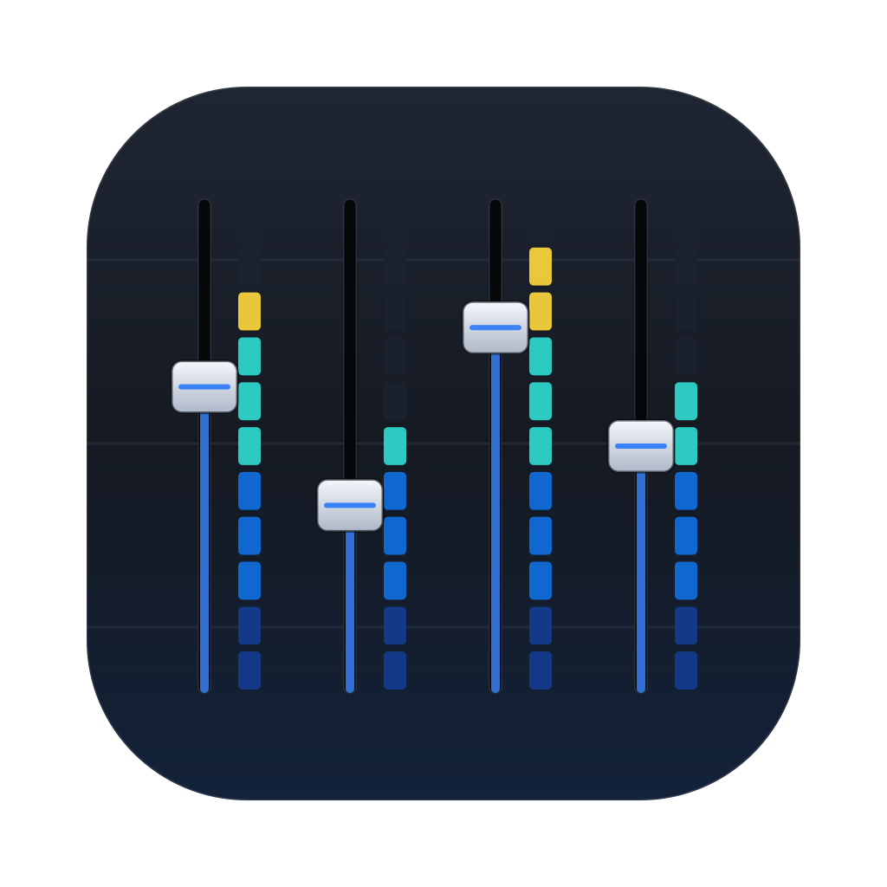
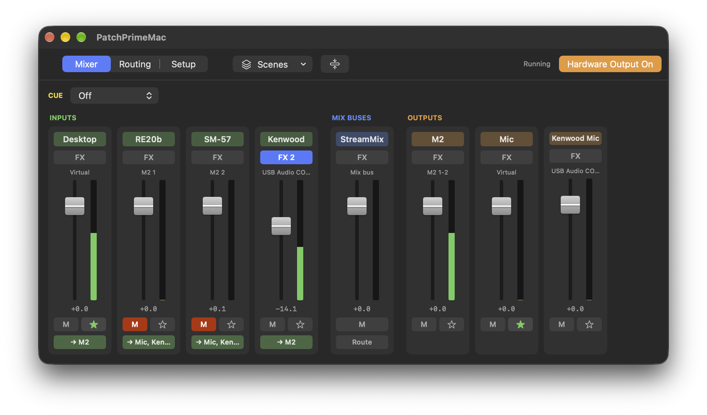

# PatchPrimeMac

A free, open-source audio mixer for macOS. It turns your Mac's audio into a small mixing console: microphones and instruments, the sound from your apps, mix buses and outputs, with effects on any of them. It runs in the background, so the sound keeps going with the window closed, and it carries on when a device is unplugged, switched off or plugged back in.



It's the Mac sibling of [Patch Prime](https://github.com/kingsqueak/patch-prime), the Linux mixer built on PipeWire: a separate native app that shares its DSP.

## What it does

- **Virtual devices** that apps play into or record from: make *Patch Desktop* the Mac's output and every app goes through the mixer; give a call or streaming app *Patch Mic* as its microphone and it hears your mics with their effects.
- **Strips, mix buses and outputs**, routed at any level from any strip or bus to any output, with mute, cue (headphones) and meters everywhere.
- **Built-in effects** on every strip, bus and output: parametric EQ, compressor, de-esser, expander, multiband compressor, noise gate, noise suppression (RNNoise), ducker, broadcast leveler, safety limiter, reverb, delay and gain, with presets.
- **Audio Unit plugins**, each hosted out of process so a crashing plugin doesn't take the mix down.
- **Recording** any strip, bus or output to FLAC, WAV or AAC, mics raw or processed, and multitrack takes that start on the same sample; a **player** that plays recordings into any bus or output, or into a mic's strip in place of the mic, to set up its effects.
- A **soundboard** of pads that play on cue into any strip, several at once, with sounds to start with: applause, cheers, laughter, horns, sirens, drums and a ba-dum-tss.
- **Scenes** that save and recall the whole mix, a **mini window**, and a command-line tool (`patchprime-ctl`).
- **Device handling** that follows a device across reconnects and driver changes, mixes devices on different clocks without drift, and refuses setups that would misbehave rather than going silent.

Full details are in the [user guide](docs/user-guide.md), which is also in the app under **Help**.

## Requirements

A Mac with Apple Silicon, macOS 26 or later.

## Installing

1. Download `PatchPrimeMac-x.y.z.dmg` from [Releases](https://github.com/kingsqueak/PatchPrimeMac/releases). The release notes list its SHA-256 if you want to check it (`shasum -a 256 ~/Downloads/PatchPrimeMac-*.dmg`).
2. PatchPrimeMac isn't signed by Apple, so macOS blocks it until you tell it to trust the download. In Terminal, run:

   ```
   xattr -dr com.apple.quarantine ~/Downloads/PatchPrimeMac-*.dmg
   ```

   Or skip this, and when macOS refuses to open the installer ("Apple cannot check it"), go to **System Settings → Privacy & Security**, scroll down and click **Open Anyway** beside PatchPrimeMac.
3. Open the DMG and double-click **PatchPrimeMac-x.y.z.pkg**. The installer asks for your password, since it installs an audio driver.
4. **Turn loud speakers or amplifiers down first:** at the end of the install, all sound on the Mac stops for a moment while macOS's audio system restarts with the driver. A few apps that are using sound (some Electron apps, such as Signal) may close; reopen them.
5. Open **PatchPrimeMac** from Applications. The first time, a **Start here** panel sets up the usual mix: where you listen, your apps' sound, your microphones, and optionally a microphone for apps.
6. When macOS asks to let **PatchPrimeMac** use the microphone, click **Allow**, or your mics stay silent.

**Updating:** the app tells you when a new version is out (a grey note in the top bar, or Help → Check for Updates…) and links to the Releases page; it never downloads anything itself. Install the new version the same way, over the old one. Your settings are kept, and if PatchPrimeMac was open it opens again. macOS asks for microphone access again after each update (each version carries its own signature rather than one from Apple, so macOS sees it as a new app): click **Allow** once more.

## Uninstalling

Open **Uninstall PatchPrimeMac** from the DMG, or **Help → Uninstall PatchPrimeMac…** in the app. It removes everything PatchPrimeMac added (the app, the engine, the driver, its entries in macOS's audio settings, logs, caches, crash reports and permissions) and puts your default sound devices back. You choose whether to keep your settings, presets and scenes.

## Building from source

Needs Xcode (macOS 26 SDK), CMake and Ninja (`brew install cmake ninja`).

```
git clone --recursive https://github.com/kingsqueak/PatchPrimeMac.git
cd PatchPrimeMac
PPMAC_SIGN=- scripts/make-release.sh
```

That builds the driver, the engine and the app, runs the tests, and leaves an ad-hoc-signed `PatchPrimeMac-<version>.pkg` and `.dmg` in `build/release`. Releases are built exactly this way, by GitHub Actions.

How it fits together:

- `driver/`: the audio driver (an AudioServerPlugIn on [libASPL](https://github.com/gavv/libASPL)) that provides the virtual devices.
- `Sources/PPCore`: the realtime mixing engine on Core Audio, with clock bridging between devices.
- `Sources/PPDSP`: the effects, shared with Patch Prime.
- `Sources/PatchPrimeEngine`: the background helper that runs the engine and hosts plugins.
- `Sources/PatchPrimeMac`: the SwiftUI app. `Sources/patchprime-ctl`: the command-line tool.
- `packaging/`: the installer, the uninstaller and the Read Me. `spikes/`: early experiments that tested the design; not product code.

## Licence

GPL-3.0-or-later (see [LICENSE](LICENSE)). It includes [RNNoise](https://github.com/xiph/rnnoise) (BSD-3-Clause, `Sources/RNNoise`) and [libASPL](https://github.com/gavv/libASPL) (MIT, `third_party/libASPL`); their notices ship with the app in `THIRD-PARTY-NOTICES.txt`.

Made by KC2RGW. Bug reports and suggestions are welcome in [Issues](https://github.com/kingsqueak/PatchPrimeMac/issues).
